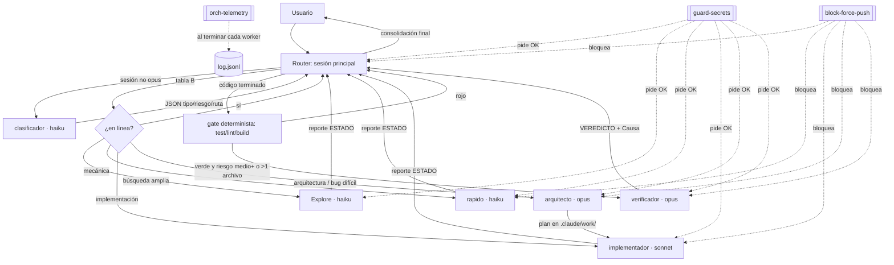

# relevo

Orquestador multimodelo para Claude Code: reparte cada tarea entre subagentes haiku, sonnet u opus, con hooks que imponen las reglas críticas para la seguridad.

[Read in English](README.md)

[](https://github.com/Turing0x/relevo/actions/workflows/ci.yml)
[](LICENSE)

> **Estado: alpha (`0.1.0`).** Espera asperezas. Algunos comportamientos aún deben comprobarse en una sesión real de Claude Code; están listados en [`docs/audit-pending.md`](docs/audit-pending.md).

## Qué es

relevo es un conjunto de archivos para [Claude Code](https://code.claude.com/docs/en/overview): una política escrita en lenguaje natural, seis subagentes («workers»), cuatro hooks, una plantilla de permisos y tres comandos. La sesión principal de Claude Code lee la política al arrancar y actúa como **router**: para cada petición decide si hace el trabajo ella misma o se lo pasa a un worker que corre en un modelo más barato o más potente.

Frente a usar un único agente para todo, aporta tres cosas (fuente: [`docs/ARCHITECTURE.md`](docs/ARCHITECTURE.md), «Propósito»):

- **Aislamiento de contexto.** Las lecturas ruidosas (búsquedas amplias, logs, salida de tests) ocurren dentro de un worker. Al router solo vuelve un reporte corto.
- **Revisión independiente.** Un `verificador` empieza con el contexto limpio y revisa el trabajo sin ver el razonamiento de quien lo hizo.
- **Paralelismo real** cuando los tramos de un plan tocan archivos disjuntos.

Además, las reglas críticas para la seguridad (nada de force push, pedir confirmación antes de tocar secretos, sin sub-subagentes) las imponen los permisos y los hooks de Claude Code, no solo el prompt. La propia política ordena al router **no** delegar cuando no aplica ninguno de los tres motivos anteriores: un worker arranca en frío y pierde contexto, así que las tareas pequeñas se hacen en línea.

Los seis workers y sus modelos:

| Worker | Modelo | Función |
|---|---|---|
| `clasificador` | haiku | Clasifica una petición en tipo, riesgo y ruta (solo se usa si la sesión principal no es opus) |
| `Explore` | haiku | Búsqueda amplia de solo lectura |
| `rapido` | haiku | Tareas mecánicas simples |
| `implementador` | sonnet | Implementación acotada (1-5 archivos) |
| `arquitecto` | opus | Arquitectura y bugs difíciles; entrega un plan |
| `verificador` | opus | Revisión y tests independientes |

### Cómo fluye una tarea



La «tabla B» es la tabla de rutas de [`docs/routing.md`](docs/routing.md). Los hooks se dibujan con líneas de puntos porque actúan sobre las llamadas a herramientas, no sobre el flujo de la tarea.

## Estado

Alpha, versión `0.1.0`. El diseño está documentado y probado a nivel de hooks e instalador, pero varios comportamientos de Claude Code aún no se han comprobado en una sesión real; están en [`docs/audit-pending.md`](docs/audit-pending.md). Espera cambios entre versiones `0.1.x`.

## Requisitos

- **Claude Code**, una versión reciente. No se fija versión mínima: relevo usa `effort`, `maxTurns`, `omitClaudeMd` y `disallowedTools` en el frontmatter de subagentes, y `agent_transcript_path` en la entrada del hook `SubagentStop`.
- **Acceso a los modelos** haiku, sonnet y opus: suscripción Claude Pro o Max.
- `python3` 3.9 o superior en el `PATH` (los hooks y el instalador son Python con biblioteca estándar), `git`, y macOS o Linux. Windows no está probado (WSL cuenta como Linux); el instalador se niega a ejecutarse en Windows nativo.

## Inicio rápido

```sh
git clone https://github.com/Turing0x/relevo.git
cd relevo
./scripts/install.sh --dry-run
./scripts/install.sh
```

Después:

1. Reinicia Claude Code y abre una sesión nueva. `/agents` debe listar los 6 workers.
2. Ejecuta `/orch-doctor` para comprobar la instalación. Es de solo lectura: cada comprobación imprime `pass`, `warn` o `fail` con un remedio que nunca aplica por su cuenta.
3. Opcional: ejecuta `/orchestrator-init` en cada proyecto donde quieras reglas a nivel de proyecto (comandos de test/lint/build, rutas sensibles).
4. Tras usarlo un tiempo, ejecuta `/orch-stats` para ver la telemetría por agente.

**Pruébalo sin tocar tu configuración.** El instalador escribe bajo `$HOME`, así que apunta `HOME` a un directorio temporal:

```sh
HOME="$(mktemp -d)" ./scripts/install.sh
```

**Actualizar:** `git pull && ./scripts/install.sh`. Los archivos que no hayas editado se actualizan en su sitio; el instalador guarda un manifest para saber cuáles son suyos. Los archivos que ya existían con contenido idéntico antes de la primera instalación no entran en el manifest: si una versión posterior los cambia, el instalador se detiene con un conflicto; revisa el diff y repite con `--force`.

**Desinstalar:** `./scripts/uninstall.sh [--prefix DIR] [--dry-run]`. Deshace exactamente lo que registra el manifest. Borra un archivo solo si relevo lo creó o lo reemplazó y su contenido sigue igual; un archivo que hayas editado se conserva (con un aviso). Un archivo que ya existía en el prefijo con contenido idéntico antes de la primera instalación no se registra, así que nunca se borra. Si instalaste con `--force`, tu archivo original se restaura desde la copia de seguridad. En `settings.json` retira solo las entradas que añadió relevo (un valor de `env` solo si no lo cambiaste, y los contenedores que creó relevo si quedan vacíos) y en `CLAUDE.md` el bloque entre los marcadores `relevo:begin` y `relevo:end`. Si relevo creó `settings.json` o `CLAUDE.md` y quedan vacíos, se borran. Tu registro de telemetría (`orchestrator/log.jsonl`) se conserva siempre. Antes de cambiar nada copia lo que retira o deshace en `<prefix>/.relevo-backups/`; elimina los directorios vacíos bajo `orchestrator/docs/`, pero puede dejar otros vacíos (`agents/`, `hooks/`...). Usa antes `--dry-run` para ver el plan.

Otras opciones del instalador: `--force` (sobrescribe los archivos en conflicto, tras hacer copia de seguridad), `--prefix DIR` (instala en un directorio distinto de `~/.claude`), `--no-settings` (no toca `settings.json`), `--no-claude-md` (no toca `CLAUDE.md`), `--pin-backup` (no borra nunca la copia de seguridad de esta ejecución). `./scripts/install.sh` se las pasa a `scripts/relevo_install.py`; `python3 scripts/relevo_install.py backups [--prefix DIR] [--pin NOMBRE | --unpin NOMBRE]` lista o fija las copias.

### Qué cambia el instalador

El prefijo por defecto es `~/.claude`. No se escribe nada fuera de él.

| Desde este repo | Se instala en | Cómo |
|---|---|---|
| `agents/*.md` (6 workers) | `agents/` | Se copian. Si el nombre choca con un agente ajeno, aborta salvo `--force` |
| `hooks/*` | `hooks/` | Se copian con modo `0755` |
| `commands/*.md` | `commands/` | Se copian |
| `orchestrator/{policy.md,project-template.md,stats.py,doctor.py,routing.json}`, `scripts/render_routing.py` | `orchestrator/` | Se copian (`doctor.py` reutiliza `render_routing.py` y `routing.json` en su comprobación `routing:sync`) |
| `docs/**` | `orchestrator/docs/**` | Se copian |
| `templates/settings.example.json` | `settings.json` | Se **fusiona**, nunca se sobrescribe (ver abajo) |
| `templates/CLAUDE.md.example` | `CLAUDE.md` | Se añade como un bloque entre `<!-- relevo:begin -->` y `<!-- relevo:end -->`, salvo que el archivo ya tenga una línea `@orchestrator/policy.md` |

Lo que añade la fusión de settings, tomado de [`templates/settings.example.json`](templates/settings.example.json):

- `env`: `CLAUDE_CODE_MAX_SUBAGENT_SPAWN_DEPTH=1` (los workers no pueden lanzar subagentes) y `CLAUDE_CODE_SUBAGENT_MODEL=sonnet` (modelo por defecto de los subagentes sin `model:`). Si ya tienes alguna con otro valor, se conserva el tuyo y el instalador avisa.
- `permissions.deny`: 2 reglas para `git push --force` / `-f`.
- `permissions.ask`: 44 reglas. Hacen que Claude Code pregunte antes de `git push`, instalar dependencias (`npm`, `pip`, `brew`, `npx`...), desplegar, `rm -r`, `git reset --hard`, editar `.env*` y los hooks, y similares. Se aplican a **todos** tus proyectos.
- `hooks`: `block-force-push` (PreToolUse sobre Bash), `guard-secrets` (PreToolUse sobre Bash, Grep y Read), `orch-telemetry` (SubagentStop, asíncrono) y `orch-resume` (SessionStart con los matchers `compact` y `resume`, timeout de 5 s: imprime el logbook de la tarea abierta `.claude/work/<tarea>/estado.md` para que los contadores de presupuesto sobrevivan a una compactación).

El resto de claves de tu configuración no se toca, y la fusión es idempotente. Antes de cambiar nada, el instalador guarda los archivos previos en `<prefix>/.relevo-backups/<marca-de-tiempo>/`. Si una copia es idéntica a otra anterior (mismo checksum), reutiliza esa; se conservan las 5 usadas más recientemente, más las fijadas y las que guardan un original reemplazado con `--force`. Si `settings.json` tiene comentarios (JSONC) o claves duplicadas, el instalador para sin escribir nada, porque al reescribirlo como JSON se perderían. Lo que añadió queda registrado en `<prefix>/orchestrator/.relevo-manifest.json`, que usa el desinstalador para deshacer exactamente eso. Lee los [hooks](hooks/) y la plantilla antes de instalar; `--dry-run` muestra un diff de `settings.json` y `CLAUDE.md` sin escribir.

## Ejemplo de uso

**Una tarea típica.** «Añade validación de email al endpoint de registro» en un proyecto con configuración de proyecto. El router estima 3 archivos, complejidad 3 y riesgo medio (recorrido de [`docs/ARCHITECTURE.md`](docs/ARCHITECTURE.md), ilustrativo):

1. El router carga `CLAUDE.md`, la política y el `.claude/orchestrator.md` del proyecto.
2. Clasifica la petición en línea si la sesión es opus; si no, lanza `clasificador`.
3. Tabla B: `implementacion` con 3 archivos va a `implementador`.
4. `implementador` recibe un brief autocontenido (sin historial de chat) y devuelve un reporte corto que empieza por `ESTADO: OK`.
5. El router ejecuta el gate determinista: test/lint/build del proyecto.
6. Como el riesgo es medio y cambió más de un archivo, un `verificador` revisa con contexto limpio. Recibe la petición original, los criterios de aceptación y la lista de archivos, nunca el razonamiento del implementador.
7. `APROBADO` lleva a un resumen final de máximo 4 líneas: gates, archivos cambiados, pendientes de aprobación y ruta usada.
8. En segundo plano, `orch-telemetry` añade una línea a `log.jsonl` cada vez que termina un worker.

Si el paso 6 devuelve `RECHAZADO`, la política re-briefea al implementador o pide un replan a `arquitecto`, según la causa indicada. Presupuesto: como máximo 1 llamada a `arquitecto` y 2 ciclos implementar→verificar por tarea. Recorrido completo: [`docs/examples/implementacion-con-rechazo.md`](docs/examples/implementacion-con-rechazo.md).

**Una acción sensible.** «Sube los cambios y despliega a producción.» El router debe parar y preguntarte, indicando los comandos exactos, su alcance y cómo deshacerlos. Si apruebas el push, Claude Code vuelve a preguntar porque `Bash(git push:*)` está en `permissions.ask`, y `block-force-push` solo lo deja pasar si no es un force push. Un force push lo deniegan `permissions.deny` y el hook aunque lo apruebes en el chat. Detalles y variantes: [`docs/examples/accion-sensible.md`](docs/examples/accion-sensible.md).

**Telemetría.** `/orch-stats` ejecuta `stats.py` e imprime una tabla por agente. La salida está en español porque sale directamente del código: la cabecera dice `Últimos 30 días — N llamadas`, seguida de columnas como `agente`, `modelo`, `turnos~`, `tope` y `estados`.

## Qué NO es / limitaciones

Léelo antes de fiarte de él.

- **No es un programa.** Las reglas de ruta, presupuesto y verificación son texto en lenguaje natural que interpreta el modelo. El modelo puede ignorarlas o aplicarlas mal. Solo los permisos y los hooks los impone Claude Code. El documento de arquitectura marca cada invariante como «impuesto» o «solo política» ([`docs/ARCHITECTURE.md`](docs/ARCHITECTURE.md#invariantes)).
- **`guard-secrets` es defensa en profundidad, no un sandbox.** Pide confirmación cuando una llamada nombra explícitamente `.env`, claves privadas o credenciales. Según la cabecera del propio hook, no detecta: un grep recursivo sobre un directorio sin nombrar el secreto, la carga implícita (dotenv, `printenv` tras `source`), la ofuscación ni la herramienta `Glob`. También da falsos positivos (nombres de secreto usados como patrón de búsqueda) y deja pasar la llamada si falla internamente.
- **`block-force-push` tiene huecos conocidos.** No detecta una variable que contenga `git` (`G=git; $G push -f`), un alias de git ni `eval "git push -f"` con el argumento entre comillas. También deja pasar la llamada si falla internamente. Corregirlos sería un cambio de hook aparte. Ver [`SECURITY.md`](SECURITY.md#ai-orchestrator-specific-risks) (en inglés).
- **`Explore` y `verificador` tienen `Bash`.** «No editar archivos» lo imponen solo sus prompts, no una restricción de herramientas.
- **Los contadores de presupuesto solo se persisten si el router los escribe.** El número de llamadas a `arquitecto` y de ciclos de revisión vive en el logbook `.claude/work/<tarea>/estado.md`, que el hook `orch-resume` imprime tras compactar o reanudar. Escribir el logbook es texto de política, no se impone.
- **Los tokens de salida de la telemetría son estimaciones** (caracteres generados dividido entre 4, sin contar el thinking). Los tokens de entrada y de caché salen del transcript.
- **Se instala a nivel de usuario.** Afecta a todos los proyectos que abras con Claude Code y añade reglas `ask` globales y hooks a tu `settings.json`.
- **`Explore` sustituye al integrado.** El archivo del worker se llama `Explore` para pisar al agente integrado de Claude Code del mismo nombre. Confirmado por los tests end-to-end con Claude Code 2.1.312 (comprobación 1 de [`docs/audit-pending.md`](docs/audit-pending.md)).
- **Varios fallos no están especificados.** La política no dice qué hace el router cuando un worker agota el tiempo, falla con un error de API o se detiene en `maxTurns`; el router improvisa. Los tests end-to-end muestran qué devuelve Claude Code en esos casos y que no queda línea de telemetría. `block-force-push` y `guard-secrets` también dan falsos positivos cuando un comando solo contiene el texto que buscan. Ver [`docs/failure-modes.md`](docs/failure-modes.md).
- **Coste.** `arquitecto` y `verificador` corren en opus, que es caro. La política limita su uso, pero no pone tope al gasto.
- **La documentación técnica está en español.** Este README y los archivos de comunidad están en inglés (con esta versión en español); [`docs/`](docs/INDEX.md) está en español.
- **No está afiliado ni respaldado por Anthropic.** «Claude» y «Claude Code» son nombres de Anthropic; este es un proyecto independiente.

## Documentación y comunidad

- Documentación técnica: [`docs/INDEX.md`](docs/INDEX.md)
- [Cómo contribuir](CONTRIBUTING.md) (en inglés) · [Política de seguridad](SECURITY.md) · [Código de conducta](CODE_OF_CONDUCT.md) · [Gobernanza](GOVERNANCE.md) · [Changelog](CHANGELOG.md) · [Licencia (MIT)](LICENSE)
- Preguntas e ideas: [GitHub Discussions](https://github.com/Turing0x/relevo/discussions)
- Documentación de Claude Code: [overview](https://code.claude.com/docs/en/overview), [subagents](https://code.claude.com/docs/en/sub-agents), [hooks](https://code.claude.com/docs/en/hooks)

## Contribuir

Las contribuciones son bienvenidas: correcciones con tests, nuevos casos de detección para los hooks, documentación y traducciones. Los commits necesitan firma DCO (`git commit -s`) y siguen Conventional Commits. Los cambios en hooks, permisos, definiciones de agentes, prompts, instalador o CI reciben una revisión más estricta. Empieza por [`CONTRIBUTING.md`](CONTRIBUTING.md) (en inglés).

## Licencia

[MIT](LICENSE) © 2026 Turing0x
