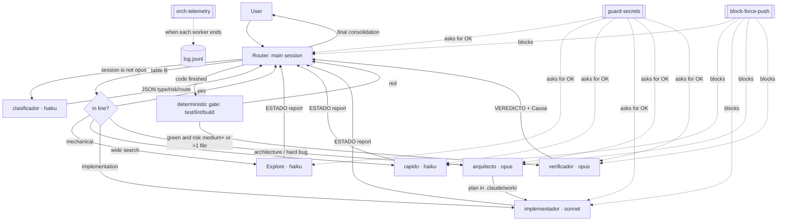

# relevo

Multi-model orchestrator for Claude Code: routes each task to haiku, sonnet or opus subagents, with hooks that enforce the safety-critical rules.

[Leer en español](README.es.md)

[](https://github.com/Turing0x/relevo/actions/workflows/ci.yml)
[](LICENSE)

> **Status: alpha (`0.1.0`).** Expect rough edges. Some behaviors still have to be verified in a live Claude Code session; they are listed in [`docs/audit-pending.md`](docs/audit-pending.md).

## What it is

relevo is a set of files for [Claude Code](https://code.claude.com/docs/en/overview): one policy written in natural language, six subagents ("workers"), four hooks, a permissions template and two slash commands. The main Claude Code session reads the policy on every start and acts as a **router**: for each request it decides whether to do the work itself or hand it to a worker running on a cheaper or stronger model.

Compared with using a single agent for everything, it gives you three things (source: [`docs/ARCHITECTURE.md`](docs/ARCHITECTURE.md), "Propósito"):

- **Context isolation.** Noisy reads (wide searches, logs, test output) happen inside a worker. Only a short report goes back to the router.
- **Independent review.** A `verificador` starts with a clean context and reviews the work without seeing the reasoning of whoever did it.
- **Real parallelism** when the pieces of a plan touch disjoint files.

On top of that, the safety-critical rules (no force push, ask before touching secrets, no sub-subagents) are enforced by Claude Code permissions and hooks, not just by the prompt. The policy itself also tells the router **not** to delegate when none of the three reasons above applies: a worker starts cold and loses context, so small tasks stay in line.

The six workers and their models:

| Worker | Model | Role |
|---|---|---|
| `clasificador` | haiku | Classifies a request into type, risk and route (only used when the main session is not opus) |
| `Explore` | haiku | Wide read-only search |
| `rapido` | haiku | Simple mechanical tasks |
| `implementador` | sonnet | Bounded implementation (1-5 files) |
| `arquitecto` | opus | Architecture and hard bugs; produces a plan |
| `verificador` | opus | Independent review and tests |

Agent names, report keywords (`ESTADO`, `VEREDICTO`) and the technical docs are in Spanish, because that is the language the project was written in. See [Limitations](#what-it-is-not--limitations).

### How a task flows



"Table B" is the routing table in [`docs/routing.md`](docs/routing.md). Hooks are drawn as dotted lines because they act on tool calls, not on the flow of the task.

## Status

Alpha, version `0.1.0`. The design is documented and tested at the hook and installer level, but several behaviors of Claude Code have not been verified in a live session yet; they are tracked in [`docs/audit-pending.md`](docs/audit-pending.md). Expect changes between `0.1.x` releases.

## Requirements

- **Claude Code**, a recent release. No minimum version is pinned: relevo relies on `effort`, `maxTurns`, `omitClaudeMd` and `disallowedTools` in subagent frontmatter, and on `agent_transcript_path` in the `SubagentStop` hook input.
- **Model access** to haiku, sonnet and opus: a Claude Pro or Max subscription.
- `python3` 3.9 or newer on your `PATH` (the hooks and the installer are standard-library Python), `git`, and macOS or Linux. Windows is untested (WSL counts as Linux); the installer refuses to run natively on Windows.

## Quickstart

```sh
git clone https://github.com/Turing0x/relevo.git
cd relevo
./scripts/install.sh --dry-run
./scripts/install.sh
```

Then:

1. Restart Claude Code and open a new session. `/agents` should list the 6 workers.
2. Optional: run `/orchestrator-init` inside each project where you want project-level rules (test/lint/build commands, sensitive paths).
3. After some use, run `/orch-stats` to see per-agent telemetry.

**Try it without touching your config.** The installer writes under `$HOME`, so point `HOME` at a throwaway directory:

```sh
HOME="$(mktemp -d)" ./scripts/install.sh
```

**Upgrade:** `git pull && ./scripts/install.sh`. Files you have not edited are updated in place; the installer keeps a manifest so it knows which files are its own. Files that already existed with identical content before your first install are not in the manifest, so if a later version changes them the installer stops with a conflict; review the diff and rerun with `--force`.

**Uninstall:** `./scripts/uninstall.sh [--prefix DIR] [--dry-run]`. It undoes exactly what the manifest records. It deletes a file only if relevo created or replaced it and its content is still unchanged; a file you edited is kept (with a warning). A file that already existed in the prefix with identical content before the first install is never recorded, so it is never deleted. If you installed with `--force`, your original file is restored from the backup. In `settings.json` it removes only the entries relevo added (an `env` value only if you did not change it, and containers relevo created if they end up empty) and in `CLAUDE.md` the block between the `relevo:begin` and `relevo:end` markers. If relevo created `settings.json` or `CLAUDE.md` and they end up empty, they are deleted. Your telemetry log (`orchestrator/log.jsonl`) is always kept. Before changing anything it copies what it removes or unmerges under `<prefix>/.relevo-backups/`; it removes empty directories under `orchestrator/docs/` but may leave other empty ones (`agents/`, `hooks/`...). Use `--dry-run` first to see the plan.

Other installer flags: `--force` (overwrite files that conflict, after backing them up), `--prefix DIR` (install somewhere other than `~/.claude`), `--no-settings` (do not touch `settings.json`), `--no-claude-md` (do not touch `CLAUDE.md`), `--pin-backup` (never delete the backup this run makes). `./scripts/install.sh` passes them to `scripts/relevo_install.py`; `python3 scripts/relevo_install.py backups [--prefix DIR] [--pin NAME | --unpin NAME]` lists or pins backups.

### What the installer changes

Default prefix is `~/.claude`. Nothing is written outside it.

| From this repo | Installed to | How |
|---|---|---|
| `agents/*.md` (6 workers) | `agents/` | Copied. A name clash with an unrelated agent aborts unless `--force` |
| `hooks/*` | `hooks/` | Copied with mode `0755` |
| `commands/*.md` | `commands/` | Copied |
| `orchestrator/{policy.md,project-template.md,stats.py}` | `orchestrator/` | Copied |
| `docs/**` | `orchestrator/docs/**` | Copied |
| `templates/settings.example.json` | `settings.json` | **Merged**, never overwritten (see below) |
| `templates/CLAUDE.md.example` | `CLAUDE.md` | Appended as a block between `<!-- relevo:begin -->` and `<!-- relevo:end -->`, unless the file already has an `@orchestrator/policy.md` line |

What the settings merge adds, taken from [`templates/settings.example.json`](templates/settings.example.json):

- `env`: `CLAUDE_CODE_MAX_SUBAGENT_SPAWN_DEPTH=1` (workers cannot spawn subagents) and `CLAUDE_CODE_SUBAGENT_MODEL=sonnet` (default model for subagents without `model:`). If you already set either to a different value, yours is kept and the installer warns.
- `permissions.deny`: 2 rules for `git push --force` / `-f`.
- `permissions.ask`: 44 rules. These make Claude Code ask before `git push`, dependency installs (`npm`, `pip`, `brew`, `npx`...), deploys, `rm -r`, `git reset --hard`, edits to `.env*` and to the hooks, and similar. They apply to **all** your projects.
- `hooks`: `block-force-push` (PreToolUse on Bash), `guard-secrets` (PreToolUse on Bash, Grep and Read) `orch-telemetry` (SubagentStop, async) and `orch-resume` (SessionStart with the matchers `compact` and `resume`, timeout 5 s: prints the open task logbook `.claude/work/<task>/estado.md` so the budget counters survive a compaction).

Your other settings keys are never touched, and the merge is idempotent. Before changing anything the installer saves the previous files under `<prefix>/.relevo-backups/<timestamp>/`. A backup identical to an earlier one (same checksum) reuses it; the 5 most recently used are kept, plus pinned ones and any that hold an original replaced with `--force`. If `settings.json` has comments (JSONC) or duplicate keys, the installer stops without writing anything, because rewriting it as JSON would lose them. What it added is recorded in `<prefix>/orchestrator/.relevo-manifest.json`, which the uninstaller uses to undo exactly that. Read the [hooks](hooks/) and the template before installing; `--dry-run` shows a diff of `settings.json` and `CLAUDE.md` without writing.

## Example

**A typical task.** "Add email validation to the signup endpoint" in a project that has a project config. The router estimates 3 files, complexity 3, medium risk (walk-through from [`docs/ARCHITECTURE.md`](docs/ARCHITECTURE.md), illustrative):

1. The router loads `CLAUDE.md`, the policy, and the project's `.claude/orchestrator.md`.
2. It classifies the request in line if the session is opus, otherwise it launches `clasificador`.
3. Table B: `implementacion` with 3 files goes to `implementador`.
4. `implementador` gets a self-contained brief (no chat history) and returns a short report that starts with `ESTADO: OK`.
5. The router runs the deterministic gate: the project's test/lint/build.
6. Because risk is medium and more than one file changed, a `verificador` reviews with a clean context. It receives the original request, the acceptance criteria and the file list, never the implementer's reasoning.
7. `APROBADO` leads to a final summary of at most 4 lines: gates, files changed, pending approvals, route used.
8. In the background, `orch-telemetry` appends one line to `log.jsonl` each time a worker finishes.

If step 6 returns `RECHAZADO`, the policy either re-briefs the implementer or asks `arquitecto` for a replan, depending on the stated cause. Budget: at most 1 `arquitecto` call and 2 implement-then-verify cycles per task. Full walk-through: [`docs/examples/implementacion-con-rechazo.md`](docs/examples/implementacion-con-rechazo.md).

**A sensitive action.** "Push the changes and deploy to production." The router must stop and ask you, naming the exact commands, their scope and how to roll back. If you approve the push, Claude Code asks again because `Bash(git push:*)` is in `permissions.ask`, and `block-force-push` lets it through only if it is not a force push. A force push is denied by `permissions.deny` and by the hook even if you approve it in chat. Details and variants: [`docs/examples/accion-sensible.md`](docs/examples/accion-sensible.md).

**Telemetry.** `/orch-stats` runs `stats.py` and prints a table per agent. Its output is in Spanish, because it comes straight from the code: the header reads `Últimos 30 días — N llamadas`, followed by columns such as `agente`, `modelo`, `turnos~`, `tope` and `estados`.

## What it is NOT / limitations

Please read this before relying on it.

- **It is not a program.** The routing, budget and verification rules are natural-language text that the model interprets. The model can ignore or misapply them. Only the permissions and the hooks are enforced by Claude Code. The architecture doc labels each invariant as "enforced" or "policy only" ([`docs/ARCHITECTURE.md`](docs/ARCHITECTURE.md#invariantes)).
- **`guard-secrets` is defense in depth, not a sandbox.** It asks for confirmation when a call explicitly names `.env`, private keys or credentials. Per its own header, it does not detect: a recursive grep over a directory without naming the secret, implicit loading (dotenv, `printenv` after `source`), obfuscation, or the `Glob` tool. It also has false positives (secret names used as a search pattern), and it fails open on an internal error.
- **`block-force-push` has known gaps.** It does not catch a variable holding `git` (`G=git; $G push -f`), a git alias, or `eval "git push -f"` with the argument in quotes. It also fails open on an internal error. Fixing these would be a separate hook change. See [`SECURITY.md`](SECURITY.md#ai-orchestrator-specific-risks).
- **`Explore` and `verificador` have `Bash`.** "Never edit files" is enforced only by their prompts, not by tool restrictions.
- **Budget counters are not persisted.** The counts for `arquitecto` calls and review cycles live in the router's context only. What happens to them when a long session is compacted has not been verified (check #6 in [`docs/audit-pending.md`](docs/audit-pending.md)).
- **Telemetry output tokens are estimates** (characters generated divided by 4, excluding thinking). Input and cache tokens come from the transcript.
- **It installs at user level.** It affects every project you open with Claude Code and adds global `ask` rules and hooks to your `settings.json`.
- **`Explore` replaces the built-in one.** The worker file is named `Explore`, which is meant to shadow Claude Code's built-in agent of the same name. Not yet confirmed: this is check #1 in [`docs/audit-pending.md`](docs/audit-pending.md) [VERIFICAR].
- **Several failure paths are unspecified.** Worker timeouts or crashes, and what a worker returns when it reaches `maxTurns`, are not defined by the policy or the hooks; the router improvises. `block-force-push` and `guard-secrets` also produce false positives when a command merely contains the trigger text. The two copies of routing table B (`orchestrator/policy.md` and `agents/clasificador.md`) are kept in sync by hand. See [`docs/failure-modes.md`](docs/failure-modes.md).
- **Cost.** `arquitecto` and `verificador` run on opus, which is expensive. The policy limits their use, but it does not cap spend.
- **Technical docs are in Spanish.** This README and the community files are in English; [`docs/`](docs/INDEX.md) is not translated yet.
- **Not affiliated with or endorsed by Anthropic.** "Claude" and "Claude Code" are Anthropic's names; this is an independent project.

## Documentation and community

- Technical documentation (in Spanish): [`docs/INDEX.md`](docs/INDEX.md)
- [Contributing](CONTRIBUTING.md) · [Security policy](SECURITY.md) · [Code of conduct](CODE_OF_CONDUCT.md) · [Governance](GOVERNANCE.md) · [Changelog](CHANGELOG.md) · [License (MIT)](LICENSE)
- Questions and ideas: [GitHub Discussions](https://github.com/Turing0x/relevo/discussions)
- Claude Code docs: [overview](https://code.claude.com/docs/en/overview), [subagents](https://code.claude.com/docs/en/sub-agents), [hooks](https://code.claude.com/docs/en/hooks)

## Contributing

Contributions are welcome: bug fixes with tests, new detection cases for the hooks, docs and translations. Commits need a DCO sign-off (`git commit -s`) and follow Conventional Commits. Changes to hooks, permissions, agent definitions, prompts, the installer or CI get extra review. Start with [`CONTRIBUTING.md`](CONTRIBUTING.md).

## License

[MIT](LICENSE) © 2026 Turing0x
