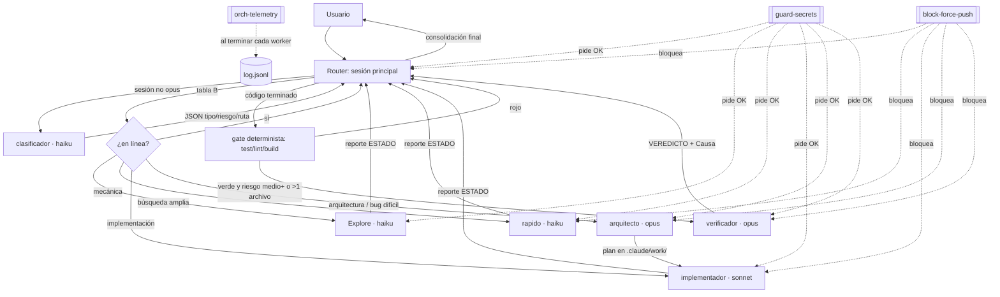

# Arquitectura del orquestador

Este archivo cubre qué es el orquestador, sus componentes, el recorrido de una tarea, sus invariantes y dónde vive el estado. Los términos se definen en [GLOSSARY.md](GLOSSARY.md). Las rutas son absolutas desde `~/.claude/`.

## Propósito

El orquestador reparte el trabajo de una sesión de Claude Code entre tres familias de modelos (haiku, sonnet, opus) según el tipo de tarea. Aporta tres cosas que un único agente no da:

- **Aislamiento de contexto.** Las lecturas ruidosas (búsquedas amplias, logs, salida de tests) ocurren en un worker y al router solo vuelve un reporte corto (`~/.claude/orchestrator/policy.md:7`, `:41`).
- **Revisión independiente.** Un `verificador` con contexto limpio revisa el trabajo sin ver el razonamiento de quien lo hizo (`~/.claude/orchestrator/policy.md:45-46`).
- **Paralelismo real** cuando los tramos tocan archivos disjuntos (`~/.claude/orchestrator/policy.md:29`, `:35`).

Su naturaleza: **no es un programa.** Es texto en lenguaje natural que el modelo de la sesión principal interpreta (`~/.claude/CLAUDE.md:6` importa `~/.claude/orchestrator/policy.md`). Claude Code solo impone por sí mismo los permisos y los hooks (ver [Invariantes](#invariantes)).

## Cuándo NO usarlo (delegar)

La política ordena trabajar en línea, sin worker, cuando delegar no aporta ninguno de los tres motivos anteriores (`~/.claude/orchestrator/policy.md:7`):

- Búsquedas de ≤3 archivos conocidos.
- Tareas mecánicas de ≤2 archivos con salida corta.
- Implementaciones de ≤2 archivos, complejidad ≤2 y riesgo no alto.

Detalle en [routing.md](routing.md). Motivo registrado: "un worker arranca en frío y pierde contexto" (`~/.claude/orchestrator/policy.md:7`); ver [decisions/0003-delegar-por-motivo.md](decisions/0003-delegar-por-motivo.md).

## Componentes

| Componente | Archivo | Impuesto por Claude Code |
|---|---|---|
| Política global | `~/.claude/orchestrator/policy.md` | No (lo interpreta el modelo) |
| Import de la política | `~/.claude/CLAUDE.md:6` | Sí (carga en cada sesión) |
| Workers (6) | `~/.claude/agents/{clasificador,Explore,rapido,implementador,arquitecto,verificador}.md` | Sí: modelo, effort, maxTurns, tools. No: el prompt |
| Permisos | `~/.claude/settings.json` `permissions.ask`/`deny` | Sí |
| Hook `block-force-push` | `~/.claude/hooks/block-force-push` (PreToolUse Bash) | Sí: bloquea (exit 2) |
| Hook `guard-secrets` | `~/.claude/hooks/guard-secrets` (PreToolUse Bash, Grep, Read) | Sí: pide confirmación (`ask`) |
| Hook `orch-telemetry` | `~/.claude/hooks/orch-telemetry` (SubagentStop, async) | Sí: escribe el log |
| Log de telemetría | `~/.claude/orchestrator/log.jsonl` | — |
| Resumen de telemetría | `~/.claude/orchestrator/stats.py`, comando `/orch-stats` (`~/.claude/commands/orch-stats.md`) | — |
| Activación por proyecto | comando `/orchestrator-init` (`~/.claude/commands/orchestrator-init.md`), plantilla `~/.claude/orchestrator/project-template.md` | — |
| Config de proyecto | `<repo>/.claude/orchestrator.md` | No |
| Límite de anidamiento | `CLAUDE_CODE_MAX_SUBAGENT_SPAWN_DEPTH=1` (`~/.claude/settings.json:3`) | Sí |
| Modelo por defecto de subagentes sin `model:` | `CLAUDE_CODE_SUBAGENT_MODEL=sonnet` (`~/.claude/settings.json:4`) | Sí |

## Recorrido de una tarea típica

Tarea ilustrativa: "añade validación de email al endpoint de registro" en un proyecto con config de proyecto. Estimación: 3 archivos, complejidad 3, riesgo medio.

| Paso | Quién | Modelo | Contexto que recibe | Qué devuelve | Fuente |
|---|---|---|---|---|---|
| 1 | Router | modelo de la sesión | Chat completo, `~/.claude/CLAUDE.md`, la política, CLAUDE.md del proyecto y `.claude/orchestrator.md` | — | `~/.claude/CLAUDE.md:6` |
| 2 | Router clasifica en línea (sesión opus) o lanza `clasificador` | opus en línea / haiku | `clasificador`: solo la petición y hasta 3 archivos; sin CLAUDE.md (`omitClaudeMd: true`) | JSON con `tipo`, `riesgo`, `complejidad`, `ruta` | `~/.claude/orchestrator/policy.md:10-11`, `~/.claude/agents/clasificador.md:8-15` |
| 3 | Router aplica tabla B: `implementacion`, 3 archivos → `implementador` | — | — | — | `~/.claude/orchestrator/policy.md:30` |
| 4 | `implementador` | sonnet, effort high | Brief (sin historial de chat), CLAUDE.md de usuario y proyecto | `ESTADO: OK`, archivos, verificación, pendientes, `Riesgo:` | `~/.claude/orchestrator/policy.md:39`, `~/.claude/agents/implementador.md` |
| 5 | Router: gate determinista con el comando de test/lint/build del proyecto | — | — | Verde o rojo | `~/.claude/orchestrator/policy.md:44` |
| 6 | `verificador` (riesgo medio y >1 archivo) | opus, effort high | Petición original literal, criterios, archivos, `base_commit` y `modo`; nunca el razonamiento del implementador | `VEREDICTO`, `Causa`, hallazgos, comandos | `~/.claude/orchestrator/policy.md:45-46`, `~/.claude/agents/verificador.md` |
| 7 | Router: `APROBADO` → consolidación final | — | — | ≤4 líneas: gates, archivos, pendientes, ruta usada | `~/.claude/orchestrator/policy.md:21`, `:63` |
| 8 | Hook `orch-telemetry` en cada fin de worker | — | Transcript del worker | Una línea en `log.jsonl` | `~/.claude/hooks/orch-telemetry:54-73` |

Si el paso 6 devuelve `RECHAZADO`, ver [routing.md](routing.md#paso-2-tabla-a-respuestas-de-worker-y-acciones-sensibles). Ejemplos completos en [examples/](examples/implementacion-con-rechazo.md).

## Invariantes

La columna "Impuesto por" distingue lo que Claude Code garantiza de lo que depende de que el modelo obedezca la política.

| Invariante | Impuesto por | Fuente |
|---|---|---|
| Ningún worker lanza subagentes. | Claude Code: `disallowedTools: Agent` o lista `tools` sin `Agent`, y `CLAUDE_CODE_MAX_SUBAGENT_SPAWN_DEPTH=1` | `~/.claude/agents/*.md:7`, `~/.claude/settings.json:3` |
| Cada worker usa siempre su modelo, effort y maxTurns del frontmatter. | Claude Code (el `model:` del frontmatter tiene prioridad sobre `CLAUDE_CODE_SUBAGENT_MODEL`) | `~/.claude/agents/*.md:4-6` |
| `clasificador` y `Explore` nunca ven CLAUDE.md. | Claude Code (`omitClaudeMd: true`) | `~/.claude/agents/clasificador.md:8`, `~/.claude/agents/Explore.md:8` |
| `clasificador` nunca ejecuta comandos ni edita. | Claude Code (`tools: Read, Grep, Glob`) | `~/.claude/agents/clasificador.md:7` |
| Nunca se ejecuta un force push ni un borrado remoto de rama vía Bash. | Claude Code: `permissions.deny` + hook `block-force-push` (exit 2) | `~/.claude/settings.json:7-10`, `~/.claude/hooks/block-force-push:40-43` |
| Siempre se pide confirmación humana antes de una referencia explícita a `.env`, claves o credenciales en Bash, Grep o Read. | Claude Code: hook `guard-secrets` + `Read(**/.env*)`/`Edit(**/.env*)` en `ask` | `~/.claude/hooks/guard-secrets`, `~/.claude/settings.json:51`, `:55` |
| Siempre se registra una línea de telemetría al terminar un worker con nombre y transcript. | Claude Code: hook `SubagentStop` | `~/.claude/settings.json:113-119`, `~/.claude/hooks/orch-telemetry:58-59` |
| `Explore`, `verificador` nunca editan archivos. | Solo prompt: ambos tienen `Bash`, que puede escribir | `~/.claude/agents/Explore.md:7`, `:10`; `~/.claude/agents/verificador.md:7`, `:12` |
| Nunca se lanza `verificador` sobre un gate determinista en rojo. | Solo política | `~/.claude/orchestrator/policy.md:44` |
| El `verificador` nunca recibe el razonamiento del implementador. | Solo política | `~/.claude/orchestrator/policy.md:46` |
| Nunca más de 1 llamada a `arquitecto` ni más de 2 ciclos por tarea sin aprobación. | Solo política (no hay contador) | `~/.claude/orchestrator/policy.md:33-34` |
| Las acciones sensibles siempre pasan por AskUserQuestion. | Solo política, salvo lo cubierto por permisos y hooks | `~/.claude/orchestrator/policy.md:15`, `:50-51` |
| Una config de proyecto nunca relaja la política. | Solo política | `~/.claude/orchestrator/policy.md:66` |

## Estado y memoria entre pasos

| Estado | Dónde vive | Quién lo lee |
|---|---|---|
| Contadores de presupuesto (llamadas a `arquitecto`, ciclos) | Solo en el contexto del router; no se persisten | Router |
| Plan y reportes largos | `<raíz git>/.claude/work/` | Router y workers por ruta |
| Telemetría | `~/.claude/orchestrator/log.jsonl` | Solo `stats.py` / `/orch-stats`; el router no la consulta al enrutar |
| Memoria persistente de workers | No existe (ningún worker declara `memory:`) | — |

Sin repo git, los workers no escriben archivo y el detalle va resumido en su salida (`~/.claude/orchestrator/policy.md:41`).
